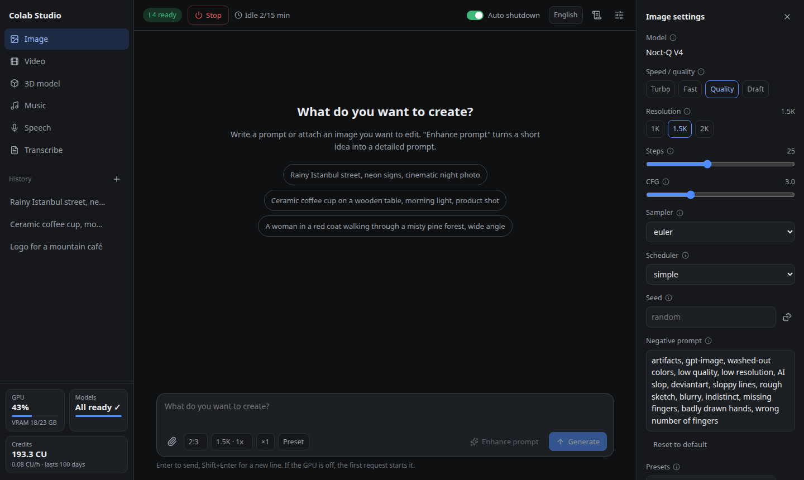
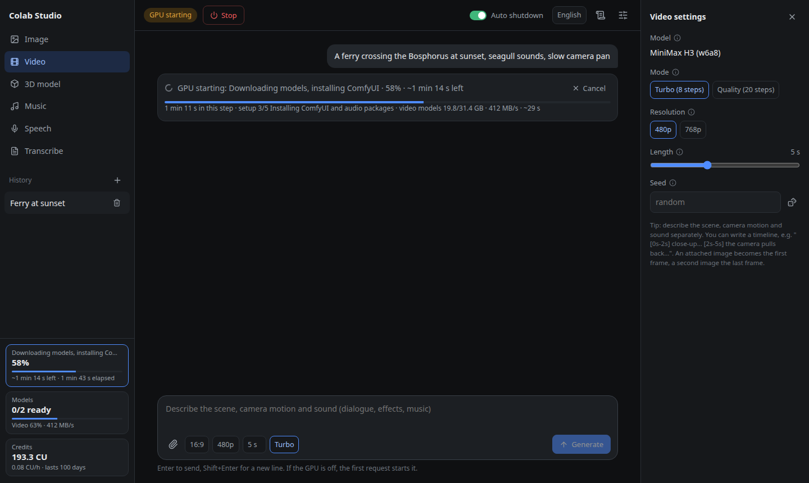
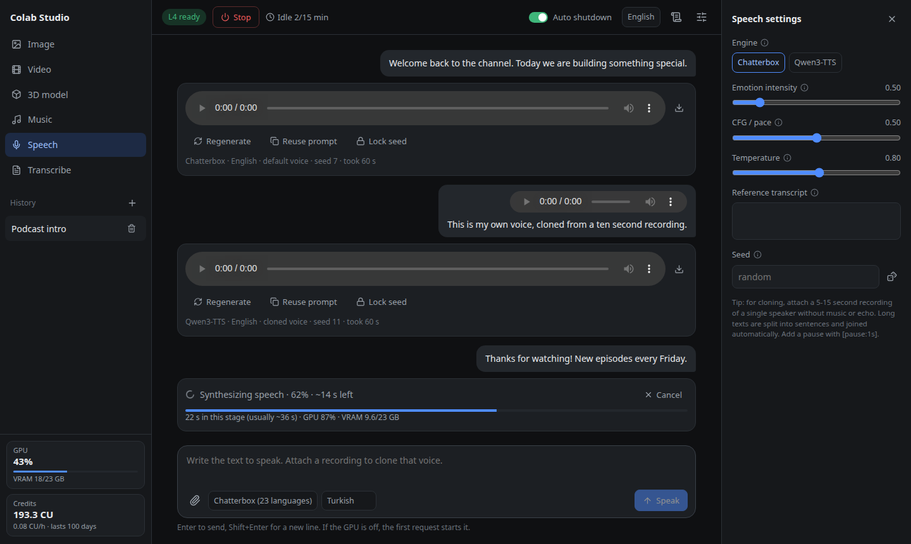
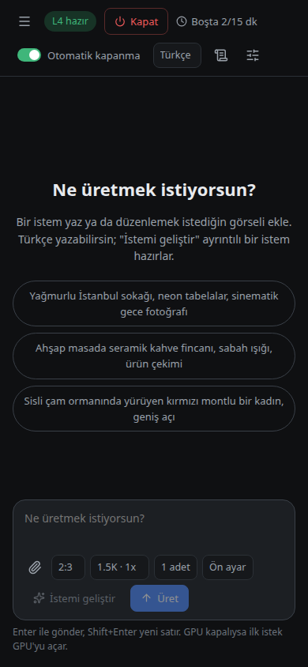
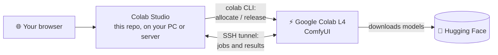

<p align="center">
  
</p>

<h1 align="center">Colab Studio</h1>

<p align="center">
  <b>Self-hosted AI media studio on a Google Colab L4 GPU.</b><br>
  Images, video with sound, music, speech, voice cloning, image-to-3D and transcription<br>
  from one chat-style web UI. The GPU is rented only while you use it.
</p>

<p align="center">
  <a href="https://github.com/berkeduruu/colab-studio/releases/latest"></a>
  <a href="https://github.com/berkeduruu/colab-studio/actions/workflows/test.yml"></a>
  <a href="LICENSE"></a>
  
  
</p>

<p align="center">
  <a href="#install"><b>Install</b></a> ·
  <a href="#features">Features</a> ·
  <a href="#docker">Docker</a> ·
  <a href="docs/models.md">Models</a> ·
  <a href="#using-it-from-claude-code-mcp">MCP</a> ·
  <a href="README.tr.md">Türkçe</a> ·
  <a href="https://berkeduruu.github.io/colab-studio/">Website</a>
</p>

<p align="center">
  
</p>

## Install

Pick the way that fits where you run it:

| You want to run it on | Use | You need |
| --- | --- | --- |
| A Linux computer or server | [the installer](#installer) (`./install.sh`) | `git`, `curl`, `ssh` (with `ssh-keygen`), `tar`, `python3` |
| Any system with Docker | [Docker](#docker) | Docker Compose v2.24 or newer |
| Windows or macOS | [Docker](#docker) (not tried yet) | Docker Compose v2.24 or newer |
| A server that others open by a domain name | either of the above, then [nginx + HTTPS + password](#opening-it-from-other-devices) | a domain pointing at the server |

Whichever you pick, you also need a **Google account with Colab compute units** (Colab Pro, Pro+ or
pay-as-you-go; the free tier does not offer L4 GPUs). An L4 consumes compute units for every hour it
runs; the sidebar shows your balance, the hourly rate and how long it will last. Linux is the tested
system; Windows (including WSL2) and macOS have not been tried, with or without Docker.

### Installer

```bash
git clone https://github.com/berkeduruu/colab-studio.git
cd colab-studio
./install.sh
./run.sh
```

It asks three questions (who may open the UI, the port, an optional Hugging Face token), writes them
to `.env`, and offers the [Google sign-in](#google-sign-in-once). It installs everything else it
needs (uv, Python 3.12, the Colab CLI); Node.js 20.19+ or 22.12+ is optional: without it (or if the
build fails) a prebuilt UI is downloaded. Then open the address it prints at the end (default
<http://127.0.0.1:8190/>) and send a prompt; the first one starts the GPU. On Debian/Ubuntu:
`sudo apt install git curl openssh-client tar python3`.

A free [Hugging Face token](https://huggingface.co/settings/tokens) (read access) is optional: models
download without one, but anonymous downloads are slower and can be rate-limited.

Installing on a server or from a script? Every question has a flag, so nothing is asked:

```bash
HF_TOKEN=hf_... ./install.sh --yes --port 8200 --host 127.0.0.1
```

(`--host` is `127.0.0.1` or `0.0.0.0`; the token is read from the environment so it does not show up in
the process list. Without a terminal the installer never waits for an answer.)

To keep the studio running in the background and start it on boot:

```bash
./install.sh --service
systemctl --user status colab-studio       # logs: journalctl --user -u colab-studio -f
```

A user service stops when you log out unless *lingering* is enabled for your account. The installer
runs `loginctl enable-linger` for you; if that needs root it prints a warning, and you run
`sudo loginctl enable-linger $USER` yourself (important on servers, where closing the SSH session
would otherwise stop the studio).

`--service` needs a **systemd user session** (a normal Linux login; not a minimal container or WSL1).
On a machine without one the installer says so, installs everything else anyway, and you start the
studio with `./run.sh`.

### Docker

```bash
docker compose run --rm studio colab usage          # one-time Google sign-in, see below
docker compose up -d                                # http://127.0.0.1:8190/ (or your STUDIO_PORT)
```

The first command builds the image (a few minutes, about 450 MB; a `pull access denied` line before
the build is normal); later starts reuse it. Chats and media live in
the `studio-data` volume and the sign-in in the `colab-login` volume.

The port is published on `127.0.0.1` (this computer only). To change the port, set a Hugging Face
token or open the studio to other devices (`STUDIO_HOST=0.0.0.0`, no password: see
[below](#opening-it-from-other-devices)), copy `.env.example` to `.env` and edit it **before** the
first `docker compose up`. After later changes run `docker compose up -d`: it recreates the
container with the new `.env` (`docker compose restart` keeps the old settings). Inside the container
`STUDIO_HOST`, `STUDIO_PORT` and `STUDIO_DATA` are fixed by `docker-compose.yml`; `STUDIO_PORT` in
`.env` only picks the published host port. A custom `models.toml` must be mounted (uncomment the line
in `docker-compose.yml`). Older Compose versions fail with `env_file ... must be a string`; the
distro `docker-compose` (v1) cannot read the file, install Docker's `docker-compose-plugin` instead.

### Google sign-in (once)

The studio starts and stops your GPU through Google's Colab CLI, which needs to be signed in to your
Google account once. It prints a link: open it in any browser, approve, and paste the code back.

| How you installed | Command |
| --- | --- |
| Installer | `./install.sh` offers it at the end (skipped when there is no terminal) |
| Later, or if you skipped it | `colab usage` |
| Docker | `docker compose run --rm studio colab usage` |

You can skip it and do it later: the studio then shows "colab CLI is not signed in" when you start
the GPU. Sign in, start the GPU again; no restart is needed. The sign-in is kept in
`~/.config/colab-cli` (Docker: the `colab-login` volume) and stays on your machine.

## Opening it from other devices

The studio has **no login of its own**. Anyone who can open the page can start the GPU and spend
your compute units, so pick one of these:

| Where it runs | How to open it |
| --- | --- |
| Your own computer | <http://127.0.0.1:8190/> (default, `STUDIO_HOST=127.0.0.1`) |
| A server, just for you | SSH tunnel: `ssh -N -L 8190:127.0.0.1:8190 user@your-server` (keep it open, or add `-f` to background it), then <http://127.0.0.1:8190/> |
| A server, on a trusted network | `STUDIO_HOST=0.0.0.0` in `.env`, then `http://<server-ip>:8190/` (no password: use a firewall) |
| A server with a domain name | `sudo ./deploy/setup-nginx.sh studio.example.com`: HTTPS (Let's Encrypt) and a password via nginx |

Opening it by IP address or `localhost` needs nothing more. **Only if you open it by a domain name**
(for example behind nginx) must that name be listed in `STUDIO_ALLOWED_HOSTS` in `.env`; otherwise
the studio answers 403. This blocks DNS rebinding attacks. `setup-nginx.sh` adds its domain for you;
with your own reverse proxy, add the name yourself and restart.

About `setup-nginx.sh`:

- It is written for **Debian/Ubuntu with systemd**: it installs nginx, certbot and apache2-utils with
  apt and uses `/etc/nginx/sites-available`; other sites on the same nginx are left alone. On other systems use your own reverse proxy;
  [`deploy/nginx.conf.template`](deploy/nginx.conf.template) is a starting point.
- Ports **80 and 443** must be reachable from the internet (Let's Encrypt checks the domain), and
  `STUDIO_HOST` must stay `127.0.0.1` so the studio is only reachable through nginx.
- Any DNS name pointing at the server works. Free names such as `<ip-with-dashes>.sslip.io` usually
  work too, but Let's Encrypt counts its weekly certificate limit for `sslip.io` as a whole, shared by
  all its users, so issuance can fail with a rate-limit error; your own domain avoids that.
- It manages **one** studio site: running it again with another domain replaces the previous one.
  If anything fails (certificate, nginx test, Ctrl+C), the previous studio site and `.env` are put back
  (an issued certificate and the password are kept for the next run).
  An e-mail for Let's Encrypt can be passed as a second argument.
- It asks for the username and password on the terminal. For scripts or CI set `STUDIO_USER` and
  `STUDIO_PASSWORD` instead (`sudo STUDIO_PASSWORD=... ./deploy/setup-nginx.sh studio.example.com`);
  with neither a terminal nor those variables it uses the user `studio` and prints a generated password.

## Features

| | Mode | What you get | Default model |
| :---: | --- | --- | --- |
| 🖼️ | **Image** | Text-to-image and image editing, up to 2K, turbo / quality presets | Noct-Q V4 (Qwen-Image 2.1 fine-tune) + turbo LoRA |
| ✨ | **Prompt enhancer** | Turns a short idea into a detailed prompt, in any language | Qwen3.5 9B prompt enhancer |
| 🎬 | **Video** | Text-to-video and image-to-video **with sound** (dialogue, effects, music), 480p / 768p | MiniMax H3 |
| 🎵 | **Music** | Full songs with vocals from lyrics and a style | YuE2 |
| 🗣️ | **Speech** | Text-to-speech in 23 languages and **voice cloning** from a short recording | Chatterbox, Qwen3-TTS |
| 📝 | **Transcription** | Speech-to-text for audio files, many languages | Whisper large-v3-turbo |
| 🧊 | **Image → 3D** | Textured GLB models from a single image, with an in-browser viewer | TRELLIS.2 |

- **Pay only while you use it.** The first job starts an L4 runtime; after 15 idle minutes it is
  released. The sidebar shows your compute-unit balance, hourly rate and how long it will last.
- **Your data stays with you.** Chats and results are copied to your own machine and survive after
  the GPU is gone. No third-party service besides Colab and Hugging Face.
- **Swap any model** with a compatible one from Hugging Face by editing one TOML file ([Models](docs/models.md)).
- **Queue, progress and ETAs** for every job, measured on the L4, including GPU start and model downloads.
- **Bilingual UI** (English, Turkish), works on phones too.
- **One-command install** (`./install.sh`), **Docker**, optional **nginx + HTTPS + password**.
- **MCP server** so Claude Code / Claude Desktop can generate media for you.

## Screenshots

<table>
  <tr>
    <td width="40%"></td>
    <td width="40%"></td>
    <td width="20%"></td>
  </tr>
  <tr>
    <td align="center"><sub>GPU start with live download progress</sub></td>
    <td align="center"><sub>Speech and voice cloning</sub></td>
    <td align="center"><sub>Mobile, Turkish UI</sub></td>
  </tr>
</table>

## How it works



1. The first job (or the **Start L4** button) allocates an L4 runtime with Google's official
   [Colab CLI](https://pypi.org/project/google-colab-cli/), connects over SSH, installs ComfyUI and
   downloads the models for that mode. This takes a few minutes; progress is shown in the sidebar.
2. Jobs are queued and run one at a time. Results are copied back to your machine, so they survive
   after the GPU is released.
3. After 15 idle minutes (configurable) the runtime is released, so it stops using compute units.

## Configuration

All settings live in `.env` (created from [`.env.example`](.env.example)); a variable already exported
in your shell wins over `.env`. Restart after changes: `systemctl --user restart colab-studio`
(service), `docker compose up -d` (Docker; `restart` would keep the old values), or Ctrl+C and
`./run.sh`. An invalid value (e.g. `STUDIO_PORT=abc`) stops the studio with a message naming it.

| Variable | Default | Meaning |
| --- | --- | --- |
| `STUDIO_HOST` | `127.0.0.1` | Listen address. `0.0.0.0` makes the UI reachable by IP (no password). |
| `STUDIO_PORT` | `8190` | Web UI port. |
| `STUDIO_ALLOWED_HOSTS` | empty | Domain names the UI may be opened by, comma-separated (`a.example.com,b.example.com`). IP addresses, `localhost` and `*.localhost` always work; other names get 403 (DNS rebinding protection). `*` turns the check off: only behind your own proxy. |
| `HF_TOKEN` | empty | Hugging Face read token; needed only for gated repos, recommended against rate limits. |
| `STUDIO_IDLE_MINUTES` | `15` | Release the GPU after this many idle minutes. The switch in the UI only turns this off or on until the next restart. |
| `STUDIO_DATA` | `~/.local/share/colab-studio` (Docker: the `studio-data` volume) | Chats, media, learned timings and the studio's own SSH key. |
| `STUDIO_MODELS` | `models.toml` in the repository root if present, else `station/models.default.toml` | Model catalog, see [Models](docs/models.md). |
| `COLAB_BIN` | `colab` on `PATH`, else `~/.local/bin/colab` | Path to the Colab CLI. |
| `STUDIO_SESSION` | `studio` | Name of the Colab session the studio owns; your other sessions are never touched (so do not use this name yourself). |

Only the L4 GPU is supported: the workflows, VRAM budgets and time estimates were all measured on it.

## Updating

```bash
./install.sh --update       # git pull, rebuild the UI, keeps your .env and models.toml
```

If the studio runs as a service, `--update` restarts it, but only when no job is running (otherwise it
tells you and leaves the restart to you). Started with `./run.sh`: restart it yourself. Docker:
`git pull && docker compose up -d --build`.

Without Node.js, `install.sh` downloads the prebuilt UI of the release in `VERSION`. If the code you
pulled has newer UI changes than that release, it says so; for that it needs the release tag in the
clone, so a ZIP download (or a clone without that tag, e.g. `--depth 1` of a commit newer than the
release) cannot tell and says so instead. Install Node.js 20.19+ or 22.12+ to build the matching UI.

## Uninstalling

```bash
./install.sh --uninstall            # removes the service, .venv and built UI; asks before deleting your data and .env
./install.sh --uninstall --purge    # also deletes chats, media and .env without asking
```

uv and the Colab CLI (`uv tool uninstall google-colab-cli`) are left alone. Docker: `docker compose down -v`
(`-v` also deletes the data volume).

## Troubleshooting

`./install.sh --doctor` checks the tools, `.env`, the port, the Colab sign-in and the service, and says what to fix.

| Symptom | Fix |
| --- | --- |
| "The colab CLI is not signed in to Google" (red notice) | Do the [Google sign-in](#google-sign-in-once), then press Start again. No restart needed; the notice stays until that next start. |
| 403 "the host name ... is not allowed" | You opened the studio by a domain name. Add it to `STUDIO_ALLOWED_HOSTS` in `.env` and restart (Docker: `docker compose up -d`). |
| GPU start fails at "Allocating GPU" | No L4 available or no compute units left. Check `colab usage`, try again later. |
| Downloads are slow or fail with 429 | Set `HF_TOKEN` in `.env` and restart. |
| A job fails after you changed `models.toml` | The new file is probably a different architecture; see [Models](docs/models.md). |
| "port ... is already in use" | Another Colab Studio (or another program) uses the port. Stop it or set another `STUDIO_PORT`. Docker: change it, then `docker compose up -d --force-recreate`. |
| `--service` says systemd is not available | This machine has no systemd user session (a minimal container, WSL1). Start the studio with `./run.sh`, or run `./install.sh --service` from a normal login on the host. |
| Two studios on one machine | Give each `.env` its own `STUDIO_PORT` **and** `STUDIO_DATA`; otherwise the second one stops with "port ... is already in use", and both would share one folder of chats and media. |
| Anything else | The log button (top right) shows the GPU start log. The studio's own output is in the terminal running `./run.sh`; with `--service`: `journalctl --user -u colab-studio`; Docker: `docker compose logs`. |

The studio only ever releases the Colab session it created (`STUDIO_SESSION`). If it was killed
while a GPU was running, it releases that runtime on its next start.

## Using it from Claude Code (MCP)

The [`mcp/`](mcp) folder contains an MCP server that lets Claude Code or Claude Desktop drive the
studio: start the GPU, generate media, wait for jobs and look at the results. It needs Node.js 22+.

```bash
./install.sh --mcp          # installs the studio (if needed), builds the MCP server, prints the command below
claude mcp add -s user colab-studio -- "$(command -v node)" "$PWD/mcp/dist/index.js"
```

There are two `install.sh` files: the one in the repository root installs the **studio**; the one in
`mcp/` builds only the **MCP server** (`--mcp` runs it for you). See [mcp/README.md](mcp/README.md) for
remote (SSH) setups and the tool list.

With [Docker](#docker), build it with `mcp/install.sh` (not `./install.sh --mcp`, which installs the studio
itself) and add it the same way: the MCP server reads everything, media included, through the studio's
API (`STUDIO_PORT` from `.env`).

## Privacy and security

- Your `.env` (Hugging Face token) and Colab sign-in stay on your machine; the token is copied only
  to your own Colab runtime so it can download models.
- Prompts, uploads and results are stored in `STUDIO_DATA` on your machine. Chats not used for 30 days
  are deleted automatically.
- ComfyUI is never exposed to the network; the studio reaches it through its own SSH tunnel.
- Write requests from other websites are rejected (CSRF protection), and so is every request that
  arrives under an unknown domain name (DNS rebinding protection, see `STUDIO_ALLOWED_HOSTS`).

## Development

```bash
./test.sh          # lint + pytest + Playwright UI tests (mocked API); no GPU needed (installs Chromium on first run)
python3 server/tests/gpu_smoke.py   # one job per mode on a real GPU (spends compute units)
```

`./test.sh` needs `uv` (run `./install.sh` first, or install it yourself) and Node.js 20.19+/22.12+ with npm.
If Chromium cannot start for lack of system libraries, run `npx playwright install-deps chromium` once
(in `server/web`, needs sudo).

| Path | Contents |
| --- | --- |
| `server/app.py` | aiohttp web service: API and UI |
| `server/runtime.py` | GPU lifecycle: allocate, connect, install, idle shutdown, credits |
| `server/studio.py` | job queue, chats, media, cleanup |
| `server/workflows.py` | ComfyUI workflow graphs |
| `server/web/` | React UI (`src/i18n.ts`, `src/en.ts`: translations) |
| `station/` | runs on the GPU: setup script, model downloader, model catalog |
| `mcp/` | MCP server (its own `install.sh` builds only this) |
| `deploy/` | systemd service, nginx templates, `doctor.sh`, `uninstall.sh` |

The API's status and error messages are in Turkish; the web UI translates them (`src/en.ts`), so
the UI is English by default. Add the English text there when you add a new server message.

Code comments are in Turkish; contributions in English or Turkish are welcome.

## License

[AGPL-3.0](LICENSE). Models, ComfyUI and its plugins have their own licenses. The prebuilt wheel
archive downloaded during GPU setup (a build cache of audio packages and SageAttention for the L4)
contains third-party packages under their respective licenses.

Colab Studio is an independent project and is not affiliated with or endorsed by Google.
Google Colab is a trademark of Google LLC.
