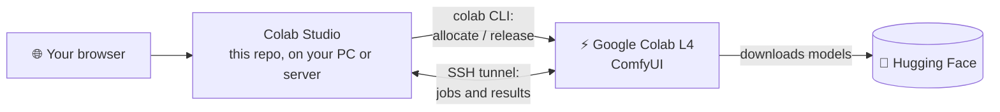

<p align="center">
  
</p>

<h1 align="center">Colab Studio</h1>

<p align="center">
  <b>Self-hosted AI media studio on a Google Colab L4 GPU.</b><br>
  Images, video with sound, music, speech, voice cloning, image-to-3D and transcription<br>
  from one chat-style web UI. The GPU is rented only while you use it.
</p>

<p align="center">
  <a href="https://github.com/berkeduruu/colab-studio/releases/latest"></a>
  <a href="https://github.com/berkeduruu/colab-studio/actions/workflows/test.yml"></a>
  <a href="LICENSE"></a>
  
  
  <br>
  
  
  
  
  <a href="https://github.com/berkeduruu/colab-studio/stargazers"></a>
</p>

<p align="center">
  <a href="#quick-start"><b>Quick start</b></a> ·
  <a href="#features">Features</a> ·
  <a href="#screenshots">Screenshots</a> ·
  <a href="#models">Models</a> ·
  <a href="#docker">Docker</a> ·
  <a href="#using-it-from-claude-code-mcp">MCP</a> ·
  <a href="README.tr.md">Türkçe</a>
</p>

<p align="center">
  
</p>

## Features

| | Mode | What you get | Default model |
| :---: | --- | --- | --- |
| 🖼️ | **Image** | Text-to-image and image editing, up to 2K, turbo / quality presets | Noct-Q V4 (Qwen-Image 2.1 fine-tune) + turbo LoRA |
| ✨ | **Prompt enhancer** | Turns a short idea into a detailed prompt, in any language | Qwen3.5 9B prompt enhancer |
| 🎬 | **Video** | Text-to-video and image-to-video **with sound** (dialogue, effects, music), 480p / 768p | MiniMax H3 |
| 🎵 | **Music** | Full songs with vocals from lyrics and a style | YuE2 |
| 🗣️ | **Speech** | Text-to-speech in 23 languages and **voice cloning** from a short recording | Chatterbox, Qwen3-TTS |
| 📝 | **Transcription** | Speech-to-text for audio files, many languages | Whisper large-v3-turbo |
| 🧊 | **Image → 3D** | Textured GLB models from a single image, with an in-browser viewer | TRELLIS.2 |

- **Pay only while you use it.** The first job starts an L4 runtime; after 15 idle minutes it is
  released. The sidebar shows your compute-unit balance, hourly rate and how long it will last.
- **Your data stays with you.** Chats and results are copied to your own machine and survive after
  the GPU is gone. No third-party service besides Colab and Hugging Face.
- **Swap any model** with a compatible one from Hugging Face by editing one TOML file ([Models](#models)).
- **Queue, progress and ETAs** for every job, measured on the L4, including GPU start and model downloads.
- **Bilingual UI** (English, Turkish), works on phones too.
- **One-command install** (`./install.sh`), **Docker**, optional **nginx + HTTPS + password**.
- **MCP server** so Claude Code / Claude Desktop can generate media for you.

## Screenshots

<table>
  <tr>
    <td width="40%"></td>
    <td width="40%"></td>
    <td width="20%"></td>
  </tr>
  <tr>
    <td align="center"><sub>GPU start with live download progress</sub></td>
    <td align="center"><sub>Speech and voice cloning</sub></td>
    <td align="center"><sub>Mobile, Turkish UI</sub></td>
  </tr>
</table>

## How it works



1. The first job (or the **Start L4** button) allocates an L4 runtime with Google's official
   [Colab CLI](https://pypi.org/project/google-colab-cli/), connects over SSH, installs ComfyUI and
   downloads the models for that mode. This takes a few minutes; progress is shown in the sidebar.
2. Jobs are queued and run one at a time. Results are copied back to your machine, so they survive
   after the GPU is released.
3. After 15 idle minutes (configurable) the runtime is released, so it stops using compute units.

## Requirements

- **Linux** (or **WSL2** on Windows). macOS is untested.
- A **Google account with Colab compute units** (Colab Pro, Pro+ or pay-as-you-go). The free tier
  does not offer L4 GPUs. An L4 consumes compute units for every hour it runs; the sidebar shows
  your balance, the hourly rate and how long it will last.
- `curl`, `ssh`, `tar` and `python3` (`sudo apt install curl openssh-client tar python3`).
  Everything else (uv, Python 3.12, the Colab CLI) is installed by `install.sh`.
- Optional: Node.js 20+ to build the web UI locally (otherwise a prebuilt copy is downloaded).
- Optional: a free [Hugging Face token](https://huggingface.co/settings/tokens) (read access).
  Models download without one, but anonymous downloads are slower and can be rate-limited.

## Quick start

```bash
git clone https://github.com/berkeduruu/colab-studio.git
cd colab-studio
./install.sh
./run.sh
```

`install.sh` asks three questions (who may open the UI, the port, an optional Hugging Face token),
writes them to `.env`, and signs the Colab CLI in to your Google account: it prints a link, you open
it in any browser, approve, and paste the code back. Then open <http://127.0.0.1:8190/> and send a
prompt; the first one starts the GPU.

To keep the studio running in the background and start it on boot:

```bash
./install.sh --service
systemctl --user status colab-studio       # logs: journalctl --user -u colab-studio -f
```

## Opening it from other devices

The studio has **no login of its own**. Anyone who can open the page can start the GPU and spend
your compute units, so pick one of these:

| Where it runs | How to open it |
| --- | --- |
| Your own computer | <http://127.0.0.1:8190/> (default, `STUDIO_HOST=127.0.0.1`) |
| A server, just for you | SSH tunnel: `ssh -L 8190:127.0.0.1:8190 my-server`, then <http://127.0.0.1:8190/> |
| A server, on a trusted network | `STUDIO_HOST=0.0.0.0` in `.env`, then `http://<server-ip>:8190/` (no password: use a firewall) |
| A server with a domain name | `sudo ./deploy/setup-nginx.sh studio.example.com`: HTTPS (Let's Encrypt) and a password via nginx |

For the nginx option keep `STUDIO_HOST=127.0.0.1`. Any DNS name pointing at the server works,
including free ones such as `<ip-with-dashes>.sslip.io`.

## Docker

```bash
cp .env.example .env                                # optional: port, HF token, ...
docker compose run --rm studio colab usage          # one-time Google sign-in (kept in a volume)
docker compose up -d                                # http://127.0.0.1:8190/
```

The port is published on `127.0.0.1` unless `STUDIO_HOST=0.0.0.0` is set in `.env`. Chats and media
live in the `studio-data` volume. A custom `models.toml` can be mounted (see `docker-compose.yml`).

## Configuration

All settings live in `.env` (created from [`.env.example`](.env.example)). Restart after changes
(`systemctl --user restart colab-studio`, `docker compose restart`, or Ctrl+C and `./run.sh`).

| Variable | Default | Meaning |
| --- | --- | --- |
| `STUDIO_HOST` | `127.0.0.1` | Listen address. `0.0.0.0` makes the UI reachable by IP (no password). |
| `STUDIO_PORT` | `8190` | Web UI port. |
| `HF_TOKEN` | empty | Hugging Face read token; needed only for gated repos, recommended against rate limits. |
| `STUDIO_IDLE_MINUTES` | `15` | Release the GPU after this many idle minutes (can also be toggled in the UI). |
| `STUDIO_DATA` | `~/.local/share/colab-studio` | Chats, media, learned timings and the studio's own SSH key. |
| `STUDIO_MODELS` | `./models.toml` if present, else `station/models.default.toml` | Model catalog. |
| `COLAB_BIN` | `colab` on `PATH` | Path to the Colab CLI. |
| `STUDIO_SESSION` | `studio` | Name of the Colab session the studio owns; your other sessions are never touched. |

Only the L4 GPU is supported: the workflows, VRAM budgets and time estimates were all measured on it.

## Models

Which files are downloaded, and which file fills each slot of each ComfyUI workflow, is defined in
[`station/models.default.toml`](station/models.default.toml). To change a model:

```bash
cp station/models.default.toml models.toml   # git-ignored, survives updates
# edit models.toml, then restart the studio
```

Each slot is a Hugging Face file:

```toml
[image]
label = "Qwen-Image 2.1"                       # shown in the settings panel
description.en = "Official base model."
description.tr = "Resmi temel model."
[image.files]
diffusion_model = { repo = "Comfy-Org/Qwen-Image-2.1", file = "diffusion_models/qwen_image_2.1_int8_convrot.safetensors", dir = "diffusion_models" }
text_encoder    = { repo = "Comfy-Org/Qwen-Image-2.1", file = "text_encoders/qwen3vl_8b_int8_convrot.safetensors", dir = "text_encoders" }
vae             = { repo = "Comfy-Org/Qwen-Image-2.1", file = "vae/qwen_image_2.1_vae_bf16.safetensors", dir = "vae" }
turbo_lora      = { repo = "Comfy-Org/Qwen-Image-2.1", file = "loras/qwen_image_2.1_turbo_lora_avg_rank_178_bf16.safetensors", dir = "loras" }
```

| Mode | Slots |
| --- | --- |
| `image` | `diffusion_model`, `text_encoder`, `vae`, `turbo_lora` |
| `enhance` | `prompt_enhancer_t2i`, `prompt_enhancer_i2i` |
| `video` | `diffusion_model`, `text_encoder`, `video_vae`, `audio_vae`, `turbo_lora` |
| `model3d` | `diffusion_model`, `clip_vision`, `shape_vae`, `texture_vae`, `background_removal` |
| `music` | `checkpoint` |
| `speech` | none; files listed as `[[speech.extra]]` are downloaded as-is |

Rules:

- A replacement must have the **same architecture** as the default (for `image`: another Qwen-Image
  2.1 model or fine-tune). The workflows are fixed ComfyUI graphs; an incompatible file fails when
  the job runs, with ComfyUI's error shown in the chat.
- It must fit the L4's 24 GB of VRAM; the defaults are quantized (int8/w6a8/nvfp4) for this reason.
- The file is checked when the studio starts: a typo or a missing slot stops it with a clear message.
- Gated repositories need `HF_TOKEN` in `.env`, from an account that accepted the model's terms.

The default image model, Noct-Q V4, is an **uncensored** fine-tune. Switch to the official
Qwen-Image 2.1 file shown above if that is not what you want. Each model has its own license; check
it on its Hugging Face page before using outputs commercially.

## Using it from Claude Code (MCP)

The [`mcp/`](mcp) folder contains an MCP server that lets Claude Code or Claude Desktop drive the
studio: start the GPU, generate media, wait for jobs and look at the results.

```bash
cd mcp && ./install.sh
claude mcp add colab-studio -- node "$PWD/dist/index.js"
```

See [mcp/README.md](mcp/README.md) for remote (SSH) setups and the tool list.

## Updating

```bash
git pull
rm -rf server/web/dist && ./install.sh     # rebuilds the UI, keeps your .env and models.toml
systemctl --user restart colab-studio      # or restart ./run.sh / docker compose up -d --build
```

## Troubleshooting

| Symptom | Fix |
| --- | --- |
| "colab CLI is not signed in" | Run `colab usage` (Docker: `docker compose run --rm studio colab usage`), sign in, restart. |
| GPU start fails at "Allocating GPU" | No L4 available or no compute units left. Check `colab usage`, try again later. |
| Downloads are slow or fail with 429 | Set `HF_TOKEN` in `.env` and restart. |
| A job fails after you changed `models.toml` | The new file is probably a different architecture; see [Models](#models). |
| Anything else | The log button (top right) shows the GPU start log; `journalctl --user -u colab-studio` the service log. |

The studio only ever releases the Colab session it created (`STUDIO_SESSION`). If it was killed
while a GPU was running, it releases that runtime on its next start.

## Privacy and security

- Your `.env` (Hugging Face token) and Colab sign-in stay on your machine; the token is copied only
  to your own Colab runtime so it can download models.
- Prompts, uploads and results are stored in `STUDIO_DATA` on your machine. Chats older than 30 days
  are deleted automatically.
- ComfyUI is never exposed to the network; the studio reaches it through its own SSH tunnel.
- Write requests from other websites are rejected (CSRF protection).

## Development

```bash
./test.sh          # lint + Playwright UI tests (mocked API) + pytest; no GPU needed
python3 server/tests/gpu_smoke.py   # one job per mode on a real GPU (spends compute units)
```

| Path | Contents |
| --- | --- |
| `server/app.py` | aiohttp web service: API and UI |
| `server/runtime.py` | GPU lifecycle: allocate, connect, install, idle shutdown, credits |
| `server/studio.py` | job queue, chats, media, cleanup |
| `server/workflows.py` | ComfyUI workflow graphs |
| `server/web/` | React UI (`src/i18n.ts`, `src/en.ts`: translations) |
| `station/` | runs on the GPU: setup script, model downloader, model catalog |
| `mcp/` | MCP server |
| `deploy/` | systemd service and nginx templates |

Code comments are in Turkish; contributions in English or Turkish are welcome.

## License

[AGPL-3.0](LICENSE). Models, ComfyUI and its plugins have their own licenses. The prebuilt wheel
archive downloaded during GPU setup (a build cache of audio packages and SageAttention for the L4)
contains third-party packages under their respective licenses.

Colab Studio is an independent project and is not affiliated with or endorsed by Google.
Google Colab is a trademark of Google LLC.
