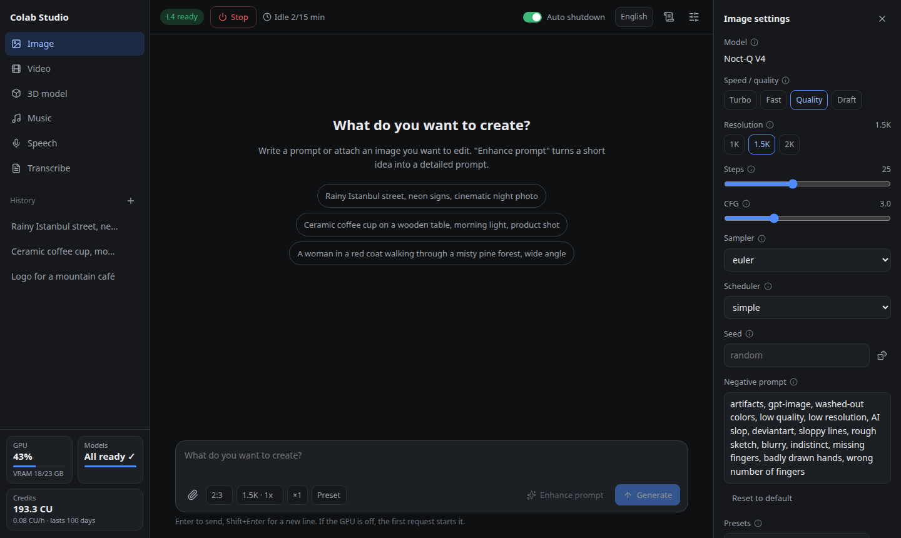
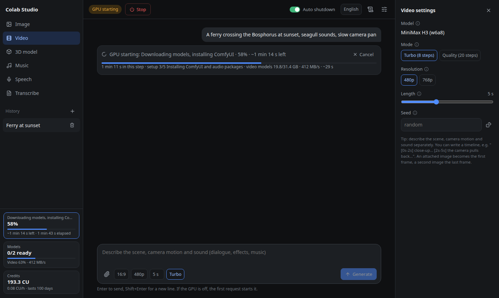
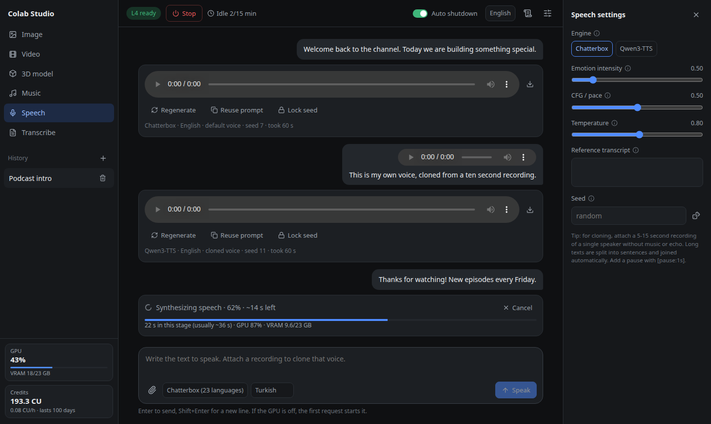
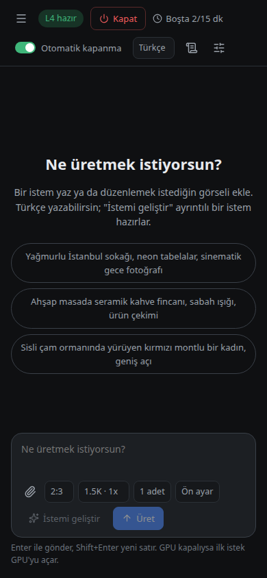
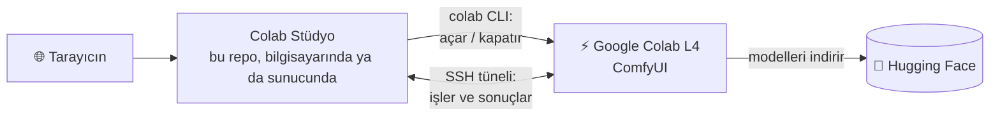

<p align="center">
  
</p>

<h1 align="center">Colab Stüdyo</h1>

<p align="center">
  <b>Google Colab L4 GPU üzerinde, kendi makinende barındırdığın yapay zekâ medya stüdyosu.</b><br>
  Görsel, sesli video, müzik, seslendirme, ses klonlama, görselden 3D ve yazıya dökme,<br>
  hepsi sohbet tarzında tek bir web arayüzünde. GPU yalnızca kullanırken kiralanır.
</p>

<p align="center">
  <a href="https://github.com/berkeduruu/colab-studio/releases/latest"></a>
  <a href="https://github.com/berkeduruu/colab-studio/actions/workflows/test.yml"></a>
  <a href="LICENSE"></a>
  
  
</p>

<p align="center">
  <a href="#kurulum"><b>Kurulum</b></a> ·
  <a href="#özellikler">Özellikler</a> ·
  <a href="#docker">Docker</a> ·
  <a href="docs/models.tr.md">Modeller</a> ·
  <a href="#claude-codedan-kullanmak-mcp">MCP</a> ·
  <a href="README.md">English</a> ·
  <a href="https://berkeduruu.github.io/colab-studio/tr/">Web sitesi</a>
</p>

<p align="center">
  
</p>

## Kurulum

Nerede çalıştıracağına göre yolu seç:

| Nerede çalıştıracaksın | Kullan | Gerekenler |
| --- | --- | --- |
| Linux bilgisayar ya da sunucu | [kurulum betiği](#kurulum-betiği) (`./install.sh`) | `git`, `curl`, `ssh` (`ssh-keygen` ile), `tar`, `python3` |
| Docker olan her sistem | [Docker](#docker) | Docker Compose v2.24 ya da üstü |
| Windows | [Docker](#docker), ya da Ubuntu'lu [WSL2](https://learn.microsoft.com/tr-tr/windows/wsl/install) ve içinde [kurulum betiği](#kurulum-betiği) | |
| Başkalarının alan adıyla açacağı bir sunucu | yukarıdakilerden biri, sonra [nginx + HTTPS + parola](#başka-cihazlardan-açmak) | sunucuyu gösteren bir alan adı |

Hangisini seçersen seç, **Colab kredisi (compute unit) olan bir Google hesabı** da gerekir (Colab Pro,
Pro+ ya da kullandıkça öde; ücretsiz katmanda L4 yok). L4 açık kaldığı her saat kredi harcar; kenar
çubuğu bakiyeni, saatlik harcamayı ve ne kadar yeteceğini gösterir. Linux ve WSL2 desteklenen
sistemlerdir; macOS denenmedi, Windows ya da macOS'ta Docker da denenmedi.

### Kurulum betiği

```bash
git clone https://github.com/berkeduruu/colab-studio.git
cd colab-studio
./install.sh
./run.sh
```

Üç soru sorar (arayüzü kimin açabileceği, port, isteğe bağlı Hugging Face token'ı), cevapları `.env`'e
yazar ve [Google girişini](#google-girişi-bir-kez) önerir. Gerisini kendisi kurar (uv, Python 3.12, Colab
CLI); Node.js 20.19+ ya da 22.12+ isteğe bağlıdır: yoksa (ya da derleme başarısız olursa) hazır
derlenmiş arayüz indirilir. Sonra sonunda yazdırdığı adresi aç (varsayılan <http://127.0.0.1:8190/>)
ve bir istem gönder; ilk istek GPU'yu açar. Debian/Ubuntu'da:
`sudo apt install git curl openssh-client tar python3`.

Ücretsiz bir [Hugging Face token'ı](https://huggingface.co/settings/tokens) (okuma yetkisi) isteğe
bağlıdır: modeller token olmadan da iner ama girişsiz indirme daha yavaş ve hız sınırına takılabilir.

Sunucuya ya da betikle mi kuruyorsun? Her sorunun bir bayrağı var, hiçbir şey sorulmaz:

```bash
HF_TOKEN=hf_... ./install.sh --yes --port 8200 --host 127.0.0.1
```

(`--host` `127.0.0.1` ya da `0.0.0.0` olur; token ortam değişkeninden okunur, böylece süreç listesinde görünmez.
Terminal yoksa kurulum betiği hiçbir cevap beklemez.)

Stüdyonun arka planda çalışması ve açılışta kendiliğinden başlaması için:

```bash
./install.sh --service
systemctl --user status colab-studio       # kayıtlar: journalctl --user -u colab-studio -f
```

Kullanıcı servisi, hesabında *lingering* açık değilse oturumu kapattığında durur. Kurulum betiği
`loginctl enable-linger` komutunu kendisi dener; root gerekirse uyarı basar, sen de
`sudo loginctl enable-linger $USER` çalıştırırsın (sunucuda önemli: SSH oturumunu kapatınca stüdyo
otomatik durmasın).

### Docker

```bash
docker compose run --rm studio colab usage          # tek seferlik Google girişi, aşağıya bak
docker compose up -d                                # http://127.0.0.1:8190/ (ya da STUDIO_PORT'un)
```

İlk komut imajı build eder (birkaç dakika, yaklaşık 650 MB; build'den önceki `pull access denied`
satırı normaldir); sonraki açılışlar hazır imajı kullanır. Sohbetler ve
medya `studio-data`, giriş bilgisi `colab-login` volume'unda durur.

Port yalnızca `127.0.0.1`'de (sadece bu bilgisayar) yayımlanır. Portu değiştirmek, Hugging Face
token'ı vermek ya da stüdyoyu başka cihazlara açmak için (`STUDIO_HOST=0.0.0.0`, şifresiz: bkz.
[aşağısı](#başka-cihazlardan-açmak)) ilk `docker compose up`'tan **önce** `.env.example`'ı `.env`
olarak kopyalayıp düzenle. Sonraki değişikliklerden sonra `docker compose up -d` çalıştır: konteyneri
yeni `.env` ile yeniden oluşturur (`docker compose restart` eski ayarları korur). Konteynerin içinde
`STUDIO_HOST`, `STUDIO_PORT` ve `STUDIO_DATA` `docker-compose.yml` tarafından sabitlenir; `.env`'deki
`STUDIO_PORT` yalnızca yayımlanan host portunu seçer. Özel bir `models.toml` bağlanmalıdır
(`docker-compose.yml`'deki satırın yorumunu kaldır). Eski Compose sürümleri `env_file ... must be a
string` hatası verir; dağıtımın `docker-compose` (v1) paketi dosyayı okuyamaz, bunun yerine Docker'ın
`docker-compose-plugin` paketini kur.

### Google girişi (bir kez)

Stüdyo GPU'nu Google'ın Colab CLI'ıyla açıp kapatır; bunun için CLI'ın Google hesabına bir kez giriş
yapması gerekir. Bir bağlantı basar: herhangi bir tarayıcıda aç, onayla, çıkan kodu yapıştır.

| Nasıl kurdun | Komut |
| --- | --- |
| Kurulum betiği | `./install.sh` sonunda önerir (terminal yoksa atlanır) |
| Sonradan ya da atladıysan | `colab usage` |
| Docker | `docker compose run --rm studio colab usage` |

Atlayıp sonra yapabilirsin: GPU'yu başlatınca stüdyo "colab CLI'da Google girişi yok" der. Giriş yap,
GPU'yu tekrar başlat; yeniden başlatmak gerekmez. Giriş `~/.config/colab-cli` altında (Docker:
`colab-login` volume'u) senin makinende kalır.

## Başka cihazlardan açmak

Stüdyonun **kendi giriş ekranı yok**. Sayfayı açabilen herkes GPU'yu başlatıp senin kredini
harcayabilir. Bu yüzden şunlardan birini seç:

| Nerede çalışıyor | Nasıl açılır |
| --- | --- |
| Kendi bilgisayarında | <http://127.0.0.1:8190/> (varsayılan, `STUDIO_HOST=127.0.0.1`) |
| Sunucuda, yalnızca sen | SSH tüneli: `ssh -N -L 8190:127.0.0.1:8190 kullanici@sunucun` (açık tut ya da arka plana atmak için `-f` ekle), sonra <http://127.0.0.1:8190/> |
| Sunucuda, güvendiğin bir ağda | `.env`'de `STUDIO_HOST=0.0.0.0`, sonra `http://<sunucu-ip>:8190/` (şifre yok: güvenlik duvarı kullan) |
| Alan adı olan bir sunucuda | `sudo ./deploy/setup-nginx.sh studio.ornek.com`: nginx ile HTTPS (Let's Encrypt) ve şifre |

IP adresi ya da `localhost` ile açmak için başka bir şey gerekmez. **Yalnızca bir alan adıyla açarsan**
(örneğin nginx arkasında) o ad `.env`'deki `STUDIO_ALLOWED_HOSTS`'ta yazılı olmalı; yoksa stüdyo 403
döner. Bu, DNS rebinding saldırılarını engeller. `setup-nginx.sh` alan adını senin için ekler; kendi
ters vekil sunucunu (reverse proxy) kullanıyorsan adı kendin ekleyip yeniden başlat.

`setup-nginx.sh` hakkında:

- **systemd'li Debian/Ubuntu** için yazıldı: nginx, certbot ve apache2-utils'i apt ile kurar ve
  `/etc/nginx/sites-available` kullanır; aynı nginx'teki diğer sitelere dokunmaz. Başka sistemlerde kendi ters vekil sunucunu kullan;
  [`deploy/nginx.conf.template`](deploy/nginx.conf.template) bir başlangıç noktasıdır.
- **80 ve 443** portları internetten erişilebilir olmalı (Let's Encrypt alan adını denetler) ve
  stüdyo yalnızca nginx üzerinden erişilsin diye `STUDIO_HOST` `127.0.0.1` kalmalı.
- Sunucuyu gösteren her DNS adı olur. `<tireli-ip>.sslip.io` gibi ücretsiz adlar da genelde çalışır,
  ama Let's Encrypt haftalık sertifika sınırını tüm `sslip.io` için, bütün kullanıcıları arasında
  paylaşarak sayar; bu yüzden sertifika alma sınır hatasıyla düşebilir. Kendi alan adın bunu önler.
- **Tek** bir stüdyo sitesi yönetir: başka bir alan adıyla tekrar çalıştırmak öncekinin yerine geçer.
  Bir şey başarısız olursa (sertifika, nginx testi, Ctrl+C) önceki nginx yapılandırması geri konur.
  Let's Encrypt için bir e-posta ikinci argüman olarak verilebilir.
- Kullanıcı adı ve parolayı terminalden sorar. Betik ya da CI için bunun yerine `STUDIO_USER` ve
  `STUDIO_PASSWORD` ver (`sudo STUDIO_PASSWORD=... ./deploy/setup-nginx.sh studio.ornek.com`); terminal de
  bu değişkenler de yoksa `studio` kullanıcısı ve üretilmiş bir parola kullanılır (parola ekrana basılır).

## Özellikler

| | Mod | Ne yapar | Varsayılan model |
| :---: | --- | --- | --- |
| 🖼️ | **Görsel** | Metinden görsel ve görsel düzenleme, 2K'ya kadar, turbo / kalite ön ayarları | Noct-Q V4 (Qwen-Image 2.1 ince ayarı) + turbo LoRA |
| ✨ | **İstem geliştirme** | Kısa bir fikri ayrıntılı bir isteme çevirir, Türkçe yazabilirsin | Qwen3.5 9B istem geliştirici |
| 🎬 | **Video** | Metinden ve görselden **sesli** video (diyalog, efekt, müzik), 480p / 768p | MiniMax H3 |
| 🎵 | **Müzik** | Söz ve tarzdan vokalli tam şarkı | YuE2 |
| 🗣️ | **Seslendirme** | 23 dilde (Türkçe dahil) seslendirme ve kısa bir kayıttan **ses klonlama** | Chatterbox, Qwen3-TTS |
| 📝 | **Yazıya dökme** | Ses dosyalarını birçok dilde yazıya döker | Whisper large-v3-turbo |
| 🧊 | **Görselden 3D** | Tek görselden dokulu GLB model, tarayıcıda 3D görüntüleyici | TRELLIS.2 |

- **Yalnızca kullanırken ödersin.** İlk iş L4 runtime'ı açar, 15 dakika boşta kalınca kapatılır.
  Kenar çubuğu kalan compute unit'ini, saatlik tüketimi ve ne kadar yeteceğini gösterir.
- **Verilerin sende kalır.** Sohbetler ve sonuçlar kendi makinene kopyalanır, GPU kapandıktan sonra
  da durur. Colab ve Hugging Face dışında hiçbir servise bağlanmaz.
- **Her model değiştirilebilir**: tek bir TOML dosyasıyla Hugging Face'teki uyumlu bir modele geç ([Modeller](docs/models.tr.md)).
- **Kuyruk, ilerleme ve kalan süre** her iş için; GPU açılışı ve model indirmeleri dahil, L4'te ölçülmüş.
- **İki dilli arayüz** (İngilizce, Türkçe), telefonda da çalışır.
- **Tek komutla kurulum** (`./install.sh`), **Docker**, isteğe bağlı **nginx + HTTPS + parola**.
- **MCP sunucusu**: Claude Code / Claude Desktop senin yerine medya üretebilir.

## Ekran görüntüleri

<table>
  <tr>
    <td width="40%"></td>
    <td width="40%"></td>
    <td width="20%"></td>
  </tr>
  <tr>
    <td align="center"><sub>Canlı indirme ilerlemesiyle GPU açılışı</sub></td>
    <td align="center"><sub>Seslendirme ve ses klonlama</sub></td>
    <td align="center"><sub>Telefon, Türkçe arayüz</sub></td>
  </tr>
</table>

## Nasıl çalışır



1. İlk iş (ya da **L4 başlat** düğmesi) Google'ın resmi [Colab CLI](https://pypi.org/project/google-colab-cli/)'ı
   ile bir L4 açar, SSH ile bağlanır, ComfyUI'yi kurar ve o modun modellerini indirir. Bu birkaç
   dakika sürer; ilerleme kenar çubuğunda görünür.
2. İşler sıraya girer ve tek tek çalışır. Sonuçlar senin makinene kopyalanır; GPU kapandıktan sonra
   da durur.
3. 15 dakika boşta kalınca (ayarlanabilir) runtime kapatılır ve kredi harcaması durur.

## Yapılandırma

Tüm ayarlar `.env` dosyasında ([`.env.example`](.env.example)'dan oluşturulur); kabukta zaten export
edilmiş bir değişken `.env`'i ezer. Değişiklikten sonra yeniden başlat: `systemctl --user restart
colab-studio` (servis), `docker compose up -d` (Docker; `restart` eski değerleri korur) ya da Ctrl+C ve
`./run.sh`. Geçersiz bir değer (ör. `STUDIO_PORT=abc`) stüdyoyu, değişkeni adıyla anan bir mesajla durdurur.

| Değişken | Varsayılan | Anlamı |
| --- | --- | --- |
| `STUDIO_HOST` | `127.0.0.1` | Dinlenen adres. `0.0.0.0` arayüzü IP ile erişilebilir yapar (şifresiz). |
| `STUDIO_PORT` | `8190` | Arayüz portu. |
| `STUDIO_ALLOWED_HOSTS` | boş | Arayüzün açılabileceği alan adları, virgülle ayrılmış (`a.ornek.com,b.ornek.com`). IP adresleri, `localhost` ve `*.localhost` her zaman çalışır; diğer adlar 403 alır (DNS rebinding koruması). `*` denetimi kapatır: yalnızca kendi vekil sunucunun arkasında. |
| `HF_TOKEN` | boş | Hugging Face okuma token'ı; yalnızca erişimi kısıtlı (gated) repolar için gerekli, hız sınırına karşı önerilir. |
| `STUDIO_IDLE_MINUTES` | `15` | GPU bu kadar dakika boşta kalınca kapatılır. Arayüzdeki anahtar bunu yalnızca bir sonraki yeniden başlatmaya kadar kapatıp açar. |
| `STUDIO_DATA` | `~/.local/share/colab-studio` (Docker: `studio-data` volume'u) | Sohbetler, medya, öğrenilmiş süreler ve stüdyonun kendi SSH anahtarı. |
| `STUDIO_MODELS` | varsa repo kökündeki `models.toml`, yoksa `station/models.default.toml` | Model kataloğu, bkz. [Modeller](docs/models.tr.md). |
| `COLAB_BIN` | `PATH`'teki `colab`, yoksa `~/.local/bin/colab` | Colab CLI'ın yolu. |
| `STUDIO_SESSION` | `studio` | Stüdyonun sahip olduğu Colab oturumunun adı; diğer oturumlarına hiç dokunulmaz (bu adı kendin kullanma). |

Yalnızca L4 GPU desteklenir: iş akışları, VRAM bütçeleri ve süre tahminlerinin hepsi L4'te ölçüldü.

## Güncelleme

```bash
./install.sh --update       # git pull, arayüzü yeniden derler; .env ve models.toml korunur
```

Stüdyo servis olarak çalışıyorsa `--update` onu yeniden başlatır, ama yalnızca çalışan iş yokken (aksi halde
söyler ve yeniden başlatmayı sana bırakır). `./run.sh` ile açtıysan kendin yeniden başlat. Docker:
`git pull && docker compose up -d --build`.

Node.js yoksa `install.sh`, `VERSION`'daki sürümün hazır arayüzünü indirir. Çektiğin kodda o sürümden
yeni arayüz değişiklikleri varsa bunu söyler (bunun için git geçmişi gerekir: `--depth 1` klon ya da
ZIP indirmede anlayamaz ve bunu söyler); uyumlu arayüzü derlemek için Node.js 20.19+ ya da 22.12+ kur.

## Kaldırma

```bash
./install.sh --uninstall            # servisi, .venv'i ve derlenmiş arayüzü siler; verini ve .env'i silmeden önce sorar
./install.sh --uninstall --purge    # sohbetleri, medyayı ve .env'i de sormadan siler
```

uv ve Colab CLI (`uv tool uninstall google-colab-cli`) olduğu gibi kalır. Docker: `docker compose down -v`
(`-v` veri volume'unu da siler).

## Sorun giderme

`./install.sh --doctor` araçları, `.env`'i, portu, Colab girişini ve servisi kontrol eder ve neyin düzeltileceğini söyler.

| Belirti | Çözüm |
| --- | --- |
| "colab CLI'da Google girişi yok" (kırmızı uyarı) | [Google girişini](#google-girişi-bir-kez) yap, sonra Başlat'a tekrar bas. Yeniden başlatmak gerekmez; uyarı o başlatmaya kadar ekranda kalır. |
| 403 "the host name ... is not allowed" | Stüdyoyu bir alan adıyla açtın. Adı `.env`'deki `STUDIO_ALLOWED_HOSTS`'a ekle ve yeniden başlat (Docker: `docker compose up -d`). |
| GPU açılışı "GPU ayrılıyor"da düşüyor | Boşta L4 yok ya da kredi bitti. `colab usage` ile bak, sonra tekrar dene. |
| İndirme yavaş ya da 429 hatası | `.env`'e `HF_TOKEN` yaz ve yeniden başlat. |
| `models.toml`'u değiştirdikten sonra iş hata veriyor | Yeni dosya büyük olasılıkla farklı bir mimaride; bkz. [Modeller](docs/models.tr.md). |
| "port ... is already in use" | Portu başka bir Colab Studio (ya da başka bir program) kullanıyor. Onu durdur ya da başka bir `STUDIO_PORT` seç. Docker: değiştir, sonra `docker compose up -d --force-recreate`. |
| Diğer her şey | Sağ üstteki kayıtlar düğmesi GPU açılış kaydını gösterir. Stüdyonun kendi çıktısı `./run.sh`'ın çalıştığı terminaldedir; `--service` ile: `journalctl --user -u colab-studio`; Docker: `docker compose logs`. |

Stüdyo yalnızca kendi açtığı Colab oturumunu (`STUDIO_SESSION`) kapatır. GPU açıkken stüdyo
öldürüldüyse bir sonraki açılışta o runtime'ı kapatır.

## Claude Code'dan kullanmak (MCP)

[`mcp/`](mcp) klasöründeki MCP sunucusu Claude Code ya da Claude Desktop'ın stüdyoyu kullanmasını
sağlar: GPU'yu başlatma, üretim, işleri bekleme ve sonuçlara bakma. Node.js 22+ gerekir.

```bash
./install.sh --mcp          # gerekirse stüdyoyu kurar, MCP sunucusunu derler, aşağıdaki komutu yazdırır
claude mcp add colab-studio -- node "$PWD/mcp/dist/index.js"
```

İki `install.sh` var: deponun kökündeki **stüdyoyu** kurar; `mcp/` içindeki yalnızca **MCP sunucusunu**
derler (`--mcp` onu senin için çalıştırır). Uzak (SSH) kurulum ve araç listesi için [mcp/README.md](mcp/README.md).

## Gizlilik ve güvenlik

- `.env` dosyan (Hugging Face token'ı) ve Colab girişin senin makinende kalır; token yalnızca model
  indirebilmesi için kendi Colab runtime'ına kopyalanır.
- İstemler, yüklemeler ve sonuçlar senin makinende `STUDIO_DATA` altında durur. 30 günden eski
  sohbetler kendiliğinden silinir.
- ComfyUI ağa hiç açılmaz; stüdyo ona kendi SSH tüneliyle ulaşır.
- Başka sitelerden gelen yazma istekleri (CSRF koruması) ve tanınmayan bir alan adıyla gelen her
  istek (DNS rebinding koruması, bkz. `STUDIO_ALLOWED_HOSTS`) reddedilir.

## Geliştirme

```bash
./test.sh          # lint + pytest + Playwright arayüz testleri (sahte API); GPU gerekmez (ilk çalıştırmada Chromium'u kurar)
python3 server/tests/gpu_smoke.py   # gerçek GPU'da her moddan bir iş (kredi harcar)
```

`./test.sh` için `uv` (önce `./install.sh` çalıştır ya da kendin kur) ve npm ile Node.js 20.19+/22.12+ gerekir.
Chromium sistem kütüphaneleri eksik diye açılmazsa bir kez `npx playwright install-deps chromium` çalıştır
(`server/web` içinde, sudo ister).

| Yol | İçerik |
| --- | --- |
| `server/app.py` | aiohttp web servisi: API ve arayüz |
| `server/runtime.py` | GPU yaşam döngüsü: açma, bağlanma, kurulum, boşta kapanma, kredi |
| `server/studio.py` | iş kuyruğu, sohbetler, medya, temizlik |
| `server/workflows.py` | ComfyUI iş akışı grafikleri |
| `server/web/` | React arayüzü (`src/i18n.ts`, `src/en.ts`: çeviriler) |
| `station/` | GPU'da çalışır: kurulum betiği, model indirici, model kataloğu |
| `mcp/` | MCP sunucusu (kendi `install.sh`'ı yalnızca bunu derler) |
| `deploy/` | systemd servisi, nginx şablonları, `doctor.sh`, `uninstall.sh` |

API'nin durum ve hata metinleri Türkçedir; web arayüzü bunları çevirir (`src/en.ts`), bu yüzden arayüz
varsayılan olarak İngilizcedir. Yeni bir sunucu mesajı eklediğinde İngilizcesini oraya da ekle.

## Lisans

[AGPL-3.0](LICENSE). Modellerin, ComfyUI'nin ve eklentilerinin kendi lisansları vardır. GPU
kurulumunda indirilen hazır wheel arşivi (L4 için ses paketleri ve SageAttention derleme önbelleği)
üçüncü taraf paketleri kendi lisanslarıyla içerir.

Colab Stüdyo bağımsız bir projedir; Google ile bağlantılı değildir ve Google tarafından
desteklenmez. Google Colab, Google LLC'nin ticari markasıdır.
